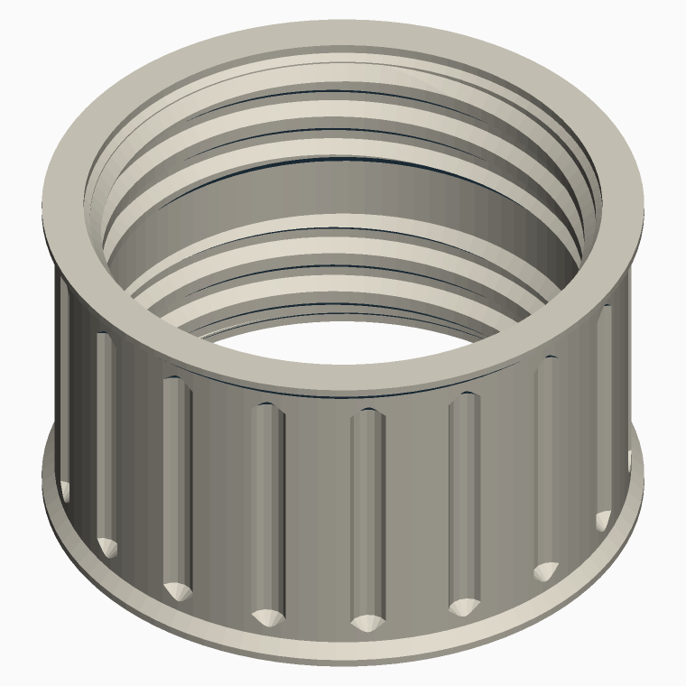

# 50 ml centrifuge tube coupler (sediment transfer adapter)

A 3D-printable collar that joins two standard 50 ml conical centrifuge tubes **mouth to mouth at their thread ends**, so a sediment core can be shaken from one tube into the other.

It is a plain double-ended threaded collar: a thread at each end and nothing in between. **The two tubes screw in until their rims meet, face to face.** There is no central wall, no shoulder, no register and no seal seat, so nothing can come between the rims and nothing narrows the passage: the bore through the middle is 31.45 mm, wider than the 30.75 mm measured over the tube's own thread, and the core drops through the tube's own bore. Vertical grip flutes run around the outside.

## What it is for

Collecting a sediment core with two 50 ml tubes, as a field method for sampling environmental microbial communities — in our case to enrich hydrogen-oxidising bacteria (HOB) for the electroPioreactor. One tube becomes a miniature corer; the coupler transfers its contents into a second tube, which is then capped and becomes the sample.

The method follows Pagaling E. *et al.* (2014) *ISME J* **8**:19–30, [doi:10.1038/ismej.2013.150](https://doi.org/10.1038/ismej.2013.150), Methods, "Sampling": "Sediment cores were taken from depths of 0.8–2.0 m using a hand-held corer" and "Water and sediment sub-samples were then taken from the cores using sterile 50 ml Falcon tubes." This part replaces the hand-held corer and the sub-sampling step with two tubes and a coupler.

### How to use it

1. Make the corer: put a hole in the bottom (the conical tip) of one tube. See **Safety** before doing this.
2. Push the corer, open end first, into the sediment, in the zone where the water rises and falls.
3. Seal the hole with a gloved finger and pull the corer out. Keep the finger on the hole.
4. Screw the coupler onto the corer, then screw the receiving tube onto the other end. Tighten both by hand until the two rims meet and stop.
5. Shake up and down until the sediment drops into the receiving tube.
6. Unscrew the receiving tube and put its own normal cap on. That capped tube is the sample. The coupler and corer are not part of the sample.

### The seal is rim against rim

The two tube rims press directly together, plastic on plastic, and that is the whole joint. There is no O-ring: outside the rim contact there is no pair of faces to squeeze one between, and anything inside the rim contact would be exactly the gap this design exists to remove. Expect it to hold wet sediment during a shake; **it is not gas-tight and was never meant to be.** Hand-tighten both tubes.

## Safety

This is a classroom and field part, published as open hardware with no warranty of any kind (see **Licence**). Anyone using it is responsible for their own risk assessment. In particular:

- **Working at the water's edge.** Step 2 puts you on soft, uneven, often slippery ground beside open water. Do not sample alone, stay within your depth, and treat this as fieldwork requiring supervision and a risk assessment, not a lab exercise carried outdoors.
- **Making the hole in the corer tube.** No method is specified here. Cutting or melting a hole in polypropylene with a knife, drill or heated tool carries cut, burn and fume risks. Use an appropriate tool, a bench, and eye protection.
- **Biological hazard.** Freshwater and estuarine sediment can carry *Leptospira* (Weil's disease), enteric bacteria, and cyanobacterial toxins. Wear gloves, cover any broken skin, do not touch your face, and wash your hands afterwards. Follow your institution's rules for handling and enriching environmental samples.
- **Not sterile, and not sterilisable.** FDM parts are porous between layers. See **Cleaning**.
- **Not a medical, diagnostic or food-contact device,** and not suitable for pressure, vacuum or hazardous materials.

## What is NOT specified here

Decide or measure these yourself; do not infer figures for them from this README.

- The size of the hole in the corer tube's bottom, and how to make it.
- How much sediment to take, or how deep to push the corer.
- How the sample is stored, for how long, at what temperature, and whether or how it is transported.
- Whether the coupler needs to be clean, disinfected or sterile for your use.
- How well a rim-to-rim joint holds against a vigorous shake with a full tube. The thread fit has been proven on a test print; the loaded shake has not been tested.

## Files

| File | What it is |
|---|---|
| `centrifuge_tube_coupler.scad` | Parametric source, no libraries needed. Every dimension is a parameter at the top of the file, in the OpenSCAD customiser sections. |
| `centrifuge_tube_coupler.stl` | **The part.** OD 35.85 mm (37.45 mm across the flanges), length 21.78 mm, 5.33 cm³ of solid, about 6.8 g in PETG. Clear bore 31.45 mm all the way through. |
| `centrifuge_tube_coupler_gauge.stl` | A single threaded ring, 10.89 mm tall — one socket of the real part, same thread, same foot. **Print this first.** |
| `centrifuge_tube_coupler_gauge_p365.stl` | The same ring at pitch 3.65 mm instead of 3.0. Print this **only if** the first ring will not start on the tube (see the pitch note below). |
| `centrifuge_tube_coupler_render.png`, `_side.png`, `_section.png`, `_bottom_edge.png` | Renders: the whole part, a cut section, and a close-up of the bottom edge. In the section views, pale blue faces are downward-facing surfaces at 45° or steeper; red would mark anything flatter than 45°, and there is none. |

STLs are exported with OpenSCAD 2025.01 (the WebAssembly build, `openscad-wasm-prebuilt`). Each is a single closed solid, checked after export. The PNGs come from a simple STL rasteriser, not OpenSCAD's preview, so the shading is flat. To re-export, open the `.scad` in OpenSCAD (2021.01 or later), set `part`, press F6 and Export STL.

## Thread dimensions: measured, not sourced

**The published drawing did not match the tube this was built for.** Corning drawing LSR00042 (for the 352070 / 352098 conical tube) gives a thread OD of 31.50 mm. The tube measured here is 30.75 mm over the crests, and the first gauge ring, built from the drawing, slid straight over it without catching. That tube may not be a 352070, or the drawing may be dimensioned differently from how it was read — either way, **the figures below are calipered measurements of a real tube, not catalogue values, and they are one person's tubes, not a standard.** Measure yours and print the gauge first.

| Parameter | Value | Readings |
|---|---|---|
| `tube_thread_od` (over the crests) | **30.75 mm** | 30.64, 30.72, 30.84, 30.75, 30.80 |
| `tube_root_od` (at the thread root, at the opening) | **28.89 mm** | 28.66, 28.81, 29.21 → tube thread depth 0.93 mm |
| `tube_body_od` (base of the thread skirt) | **27.69 mm** | |
| `thread_pitch` | **3.0 mm** | crest-to-crest 3.00, 3.39, 3.12, 2.98, 2.94 (mean 3.09); 3-crest span 6.03 over 2 gaps = 3.02 |
| `tube_ridge_w` (the tube's own ridge, axially) | **1.12 mm** | 1.08, 1.19, 1.16, 1.05 → the groove to fill is 3.0 − 1.12 = 1.88 mm |
| `tube_thread_top` / `tube_thread_end` (below the rim) | **1.67 / 9.89 mm** | thread zone 8.22 mm long |
| `tube_rim_id` | 27.81 mm | **Not measured** — from the drawing above, so unverified here. Nothing in the part depends on it. |
| Cap that grips, internal crest ID | 29.97 mm | proves about 0.39 mm of radial engagement works |

**Pitch, and a note on the turn count:** the two direct measurements give 3.0 mm. Counting the turns by eye over the 8.22 mm thread zone gave "2¼", which would imply 3.65 mm. The part is built at 3.0 mm, because that is what was measured directly and it gives 2.74 turns over the same zone — close to the count, and a turn you cannot see round the back of the tube is easy to undercount. **A gauge ring at 3.0 mm has been printed and screws onto a real tube correctly.** `centrifuge_tube_coupler_gauge_p365.stl` is the same ring at 3.65 mm, kept in case someone's tubes differ.

**What the printed thread aims at:** the printed crest is drawn at **30.0 mm**. The first gauge printed 0.2 mm small on diameter (30.40 drawn, 30.18 measured), so 30.0 drawn comes out near 29.8, which bites 0.47 mm into the tube's 30.75 mm crests — a little deeper than the 0.39 mm of the cap that grips, deliberately, because a printed crest rounds off. The ridge is 0.725 mm high in a 0.93 mm deep groove, and 1.63 mm thick at mid depth in a 1.88 mm groove, leaving 0.25 mm of total flank clearance. The bore stays at 31.45 mm, clearing the tube's crests by 0.35 mm a side as drawn (0.25 mm after shrinkage).

Note: Pyrex and Kimble *glass* 50 ml tubes use GPI 24-400 / 24-410 finishes. These are different tubes and do not apply here.

### Measure your tube (2 minutes, calipers)

- **Pitch:** lay calipers along the side of the thread and measure the span across as many crests as you can see, say N crests. Pitch = span ÷ (N − 1). Count the starts too: follow one ridge round, and if a second ridge begins beside it, the thread is two-start.
- **Thread OD:** measure across the crests. Expect roughly 30.5–31.5 mm; do not assume a catalogue figure.
- **Root:** measure across the grooves. This gives the thread depth = (OD − root) ÷ 2.
- **Thread length:** measure from the rim to the bottom of the last full thread, and from the rim to the top of the first.

Put these values into the top of the `.scad` and re-export.

## Printing

Print **`centrifuge_tube_coupler_gauge.stl` first** — about 15 minutes, in the same material and at the same settings as the final part, because the fit depends on both. Only print the coupler once the gauge screws onto a real tube properly (see **Test-fit**).

- **Orientation:** upright, exactly as modelled, axis vertical, a flange on the bed. Do not lay it on its side.
- **Supports:** none. There is no bridge anywhere — the bore is one straight through-hole — and no downward-facing surface is flatter than 45°.
- **Brim:** none. The part has its own: a 0.8 mm flange that is part of the model, giving a continuous 2.6 mm wide first-layer ring (32.25 → 37.45 mm diameter, about 285 mm² on the bed). Pare it off with a knife afterwards if you want to; it is outside everything that matters. Set `foot_flange = 0` to use a slicer brim instead.
- **Layer height:** 0.12–0.16 mm with a 0.4 mm nozzle. Fine layers matter for the thread.
- **Perimeters / infill:** 4 perimeters or more, 4+ top and bottom layers, and **100 % infill** — the part is only about 6.8 g, and a hand-tightened thread at low infill can strip. On a Prusa MINI+ that is roughly 42 minutes.
- **Material:** PETG is recommended; it tolerates 70 % ethanol and dilute bleach. PLA prints fine and is acceptable for a classroom part, but it softens at 55–60 °C, so no hot washing. **Neither can be autoclaved** (plain PETG deforms at 121 °C). For autoclaving you need PP, or a high-temperature material such as PC or PA-CF, and the fit must be re-tested in that material.
- **Elephant's foot:** the first 0.6 mm of each bore is deliberately relieved by 0.4 mm radially, so a squashed first layer cannot narrow the thread entry. Even so, keep first-layer squish normal and use your slicer's elephant-foot compensation if you have it.
- **Cooling / speed:** normal. The thread's underside is a 45° self-supporting slope; slowing the outer perimeter a little gives a cleaner thread.

### Test-fit with one tube first

1. Print `centrifuge_tube_coupler_gauge.stl`. Screw it onto an empty tube by hand.
   - **Smooth with a little drag** is the fit you want.
   - If it **slides straight over without catching**, the crest is too wide: lower `crest_dia_design` (it is 30.0; try 29.6) and reprint. This is what happened with the first ring, built from the catalogue figure.
   - If it **won't start or binds** in the first turn, raise `crest_dia_design` by 0.2, or `radial_clearance` by 0.1.
   - If it **starts but locks after half a turn**, the pitch is wrong. Print `centrifuge_tube_coupler_gauge_p365.stl` (pitch 3.65) and try that.
   - If it is **sloppy or wobbles**, lower `crest_dia_design` by 0.2.
   - Measure the ring's internal crest diameter after printing and compare with 30.0, to keep the shrinkage figure honest.
2. Only now print the full coupler. Screw both tubes in by hand and check that they stop against each other, rim to rim, with no gap you can see or feel. If a tube bottoms out before the rims touch, the thread is engaging too early: reduce the thread length to the figure you measured.
3. Fill one tube with water, couple the two, invert and shake. Check for leaks at the joint before trusting it with mud.
4. Dry run the transfer: put wet sand or mud in a tube, couple it to an empty one and shake. Check that it drops through and the joint does not leak.

## Design notes

- **Face to face:** each half is 10.89 mm from the end face to the middle plane, so a fully screwed-in tube puts its rim exactly there. The printed thread runs from 1 mm to 8.92 mm from each end (2.64 turns), which is exactly where the tube's own thread sits when its rim is on the middle plane, stopping 0.3 mm short of the plain neck above the tube's thread. That leaves a 3.9 mm plain band across the middle, bored to 31.45 mm. Nothing protrudes into that band.
- **No stop shoulder on purpose:** the tubes are stopped by each other, not by the part. A shoulder or register would have to sit inside the thread-crest diameter to work, and could then stop a tube early and leave the gap this design removes.
- **Symmetric flanges:** the same 0.8 mm wide, 0.5 mm thick flange at both ends, so neither end looks like the right way up — either one takes a tube. The top one is the bottom one mirrored, so its underside is a 45° cone flaring outward as it rises, not a square disc; it prints without support and adds nothing to the overall height, which stays 21.78 mm. Set `flange_both_ends = false` for a plain chamfered top.
- **Grip flutes:** inset 1.6 mm at both ends (span 18.58 mm), so they clear both flanges and leave each one an unbroken ring, and so they cannot chop the first layer into 18 separate islands. Each flute is tapered 45° at both ends: a plain cylinder has a flat cap, which would leave 18 small flat ceilings in the grooves.
- **First layer:** 2.6 mm wide and continuous. The outer chamfer is on the top end only — an outer chamfer at the bottom was what made the first layer 0.4 mm wide in an earlier revision.
- **Overhangs, measured from the exported STL:** no downward-facing triangle is flatter than 45° apart from the bed face itself. The thread's lower flanks are a true 45°, and the two ends of each thread ridge are ramped out as 45° cones instead of being cut off flat (which also makes the thread easier to start).
- **Thread handedness:** right-hand at both ends, like a normal cap. The upper half is rotated into place, not mirrored, because a mirror would make it left-hand.
- **Threads:** generated by a self-contained helical `polyhedron` module (`helix_ridge`). BOSL2 is not required.
- **`part = "section"`** is a cutaway for inspection only. It prints as a half-shell and is not exported as an STL; the file echoes a warning if you select it.

## Cleaning

- FDM parts are porous between layers and cannot be reliably sterilised. Wiping or soaking in 70 % ethanol (or 1 % Virkon / dilute bleach, then rinsing) gives *disinfection*, not sterility. Treat the coupler as clean, not sterile. The sample ends up in the receiving tube under its own cap, so the coupler only touches the sediment during the shake.
- **Do not autoclave** PLA or PETG parts. See **Material** above.

## Sources

- Pagaling E. *et al.* (2014) *ISME J* **8**:19–30, [doi:10.1038/ismej.2013.150](https://doi.org/10.1038/ismej.2013.150), Methods, "Sampling".
- Corning, *Conical Tube 50 mL 352070 / 352098*, technical drawing LSR00042: https://www.corning.com/catalog/cls/documents/drawings/LSR00042_Falcon_Conical_Tube_50mL_352070_352098.pdf — cited for provenance only; see **Thread dimensions** for why no dimension is taken from it.
- Corning 358206 flat-top screw caps for 50 ml tubes (33 mm OD, 13 mm length): https://ecatalog.corning.com/life-sciences/b2b/KR/en/General-Labware/Caps/Falcon%C2%AE-Polyethylene-Flat-Top-Screw-Caps-for-50-mL-Conical-Bottom-Centrifuge-Tubes,-Sterile,-50-Pack,-1000-Case/p/358206
- Corning 352070 catalogue page: https://ecatalog.corning.com/life-sciences/b2c/US/en/p/352070
- Glass-tube GPI 24-400/24-410 finishes (shown for contrast only, not used): https://ecatalog.corning.com/life-sciences/b2b/KR/en/Glassware/Centrifuge-Tubes,-Glass/PYREX%C2%AE-Disposable-Glass-Conical-Centrifuge-Tubes,-Ungraduated,-without-Screw-Cap/p/99502-50
- Thread-measuring method (span across N crests ÷ turns), and why ~0.4 mm printed clearance is typical: DrLex0, *print3d-customizable-screw-cap*: https://github.com/DrLex0/print3d-customizable-screw-cap

The figures from the Corning PDFs were read from search-result extracts, as the PDFs could not be fetched directly. Check them against a real tube with calipers.

*Falcon, Corning and Pyrex are trademarks of their respective owners, used here only to identify the tubes this part was measured against. This part is not affiliated with, endorsed by or supplied by any of them.*

## Licence

Copyright © 2026 andeye Ltd (trading as AMYBO).

The `.scad` source, the STLs and any physical part made from them are licensed under the **[CERN Open Hardware Licence Version 2 — Strongly Reciprocal (CERN-OHL-S-2.0)](LICENSE.txt)**. `SPDX-License-Identifier: CERN-OHL-S-2.0`

> This source describes Open Hardware and is licensed under the CERN-OHL-S v2. You may redistribute and modify this source and make products using it under the terms of the CERN-OHL-S v2 (https://ohwr.org/cern_ohl_s_v2.txt). This source is distributed WITHOUT ANY EXPRESS OR IMPLIED WARRANTY, INCLUDING OF MERCHANTABILITY, SATISFACTORY QUALITY AND FITNESS FOR A PARTICULAR PURPOSE. Please see the CERN-OHL-S v2 for applicable conditions.

Source location: https://github.com/amy-bo/electroPioreactor/tree/main/Components/CentrifugeTubeCoupler

The renders (`*.png`) are licensed [CC-BY-SA-4.0](https://creativecommons.org/licenses/by-sa/4.0/) as AMYBO images.

**More permissive terms** are available from AMYBO, either by entering a contract to pay reasonable royalties, or — where the design is used exclusively in [Least Developed Countries](https://www.un.org/ohrlls/content/list-ldcs) — by providing AMYBO with regular updates on how people are benefiting from it.
